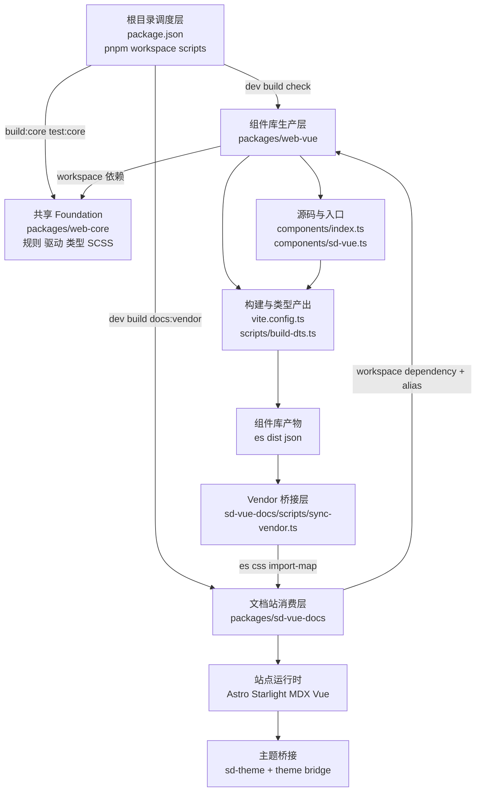
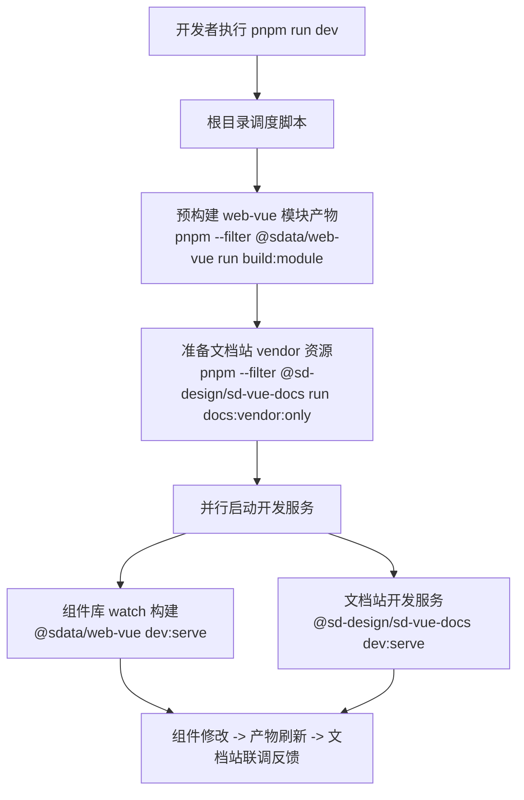
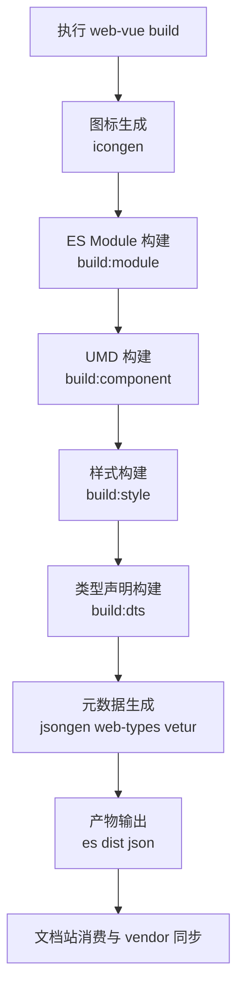

# SD Design 前端架构说明

## 总览

以 `packages/web-core` 为共享 Foundation、`packages/web-vue` 为 Vue Adapter/View、`packages/sd-vue-docs` 为消费与展示层的分层架构。未来框架包复用 Core，单独实现框架视图与适配，不引入 Web Components。

- 根目录负责统一调度开发、构建、校验和发布前检查。
- `packages/web-core` 负责无框架状态/规则、原生浏览器驱动、共享类型、SCSS/token 和主题生成。
- `packages/web-vue` 负责 Vue 响应式、生命周期、VNode/插槽、框架专属依赖接线，以及旧组件/深入口、类型声明和 IDE 元数据兼容。
- `packages/sd-vue-docs` 负责文档页面、在线示例、主题桥接和站点构建。
- `packages/sd-mcp` 负责把组件 API 元数据封装为 MCP 服务，供 AI 助手查询。

## TypeScript 源码与运行边界

面向组件使用者与维护者的 F/A 设计说明见[跨框架技术方案](packages/sd-vue-docs/src/content/docs/guides/architecture.mdx)。该页从 Select 的交互拆解进入分层设计，以 Collapse 实际源码解释 getter/setter 契约、事件顺序、受控回写和生命周期，并使用 AntV Infographic 绘制组件内部架构与调用链两张图。图中的 View、状态与 Adapter 属于 Vue 包，Foundation、原生驱动和共享样式属于 Core；未来框架适配明确标为扩展方向。下文模块关系图补充仓库构建与文档消费关系。

项目维护的所有业务与工具源码使用 `.ts` / `.mts` / `.tsx`，包含文档站的 Astro 配置、集成、生成与同步脚本，以及 MCP、自动导入解析器、发布配置。Vue 组件逻辑使用 `<script setup lang="ts">`；纯模板组件无需增加空脚本。模块级计数器和常量放入独立 TS 模块，保留各组件实例共享状态的语义。

Node 24 直接执行维护脚本，以 `tsconfig.scripts.json` 的 `NodeNext`、`strict`、`erasableSyntaxOnly` 和 `verbatimModuleSyntax` 约束原生可执行语法。脚本导入写明 `.ts` / `.mts` 扩展名，类型导入使用 `import type`。Node 运行时只擦除类型，不负责检查。根目录 `typecheck` 依次检查生成准备、源码约定、脚本、Vue 工作区、MCP 和解析器，统一使用精确锁定的 TS7/TNB。

提交交互使用 `czg`，通过 `pnpm cz` 启动；中文提示、提交类型和 emoji 与校验规则集中在 `commitlint.config.ts`。依赖升级使用现有 `pnpm update` 流程，不保留 npm-check-updates 配置。编译后的 `es` / `dist`、文档站同步的 `public/vendor`、第三方依赖与外部技能包使用上游或目标运行环境需要的格式，不作为维护源码转换。浏览器内联脚本和 REPL 生成内容同样需要输出可执行 JavaScript。REPL 根据浏览器运行时清单生成的值导出声明仍使用动态类型占位：该清单仅记录导入路径，不包含泛型函数和组件值的完整签名；这些沙箱声明不参与工作区源码检查。

`.gitattributes` 将 `.agents/**` 与 `.claude/**` 标记为第三方代码，整个目录不参与 GitHub 语言统计。

类型边界使用 `unknown` 和明确的数据结构；第三方未公开的运行时接口（例如 Day.js `$utils`）在调用边界描述最小结构。虚拟列表和 List 通过 Vue 泛型传播项类型，泛型组件的公开实例类型通过 `ComponentExposed` 提取，提供该类型的 `vue-component-type-helpers` 随组件库作为正式依赖发布。

面板分割统一使用 `PanelGroup`、`Panel` 与 `PanelSeparator`，原 `Split` 已移除。组件组支持受控/非受控尺寸、实时尺寸更新、拖拽生命周期事件、禁用调整、动态方向和自定义根标签；尺寸数值表示像素，百分比使用字符串。

## 模块关系图

## 技术栈

- Monorepo：`pnpm workspace`
- 共享层：无框架 TypeScript Foundation、原生浏览器驱动、SCSS/token；独立 ESM/声明包 `@sdata/web-core`
- Vue 适配层：`Vue 3`、`TypeScript`、`Vite`、`vite-plus`；Floating UI、motion-v、virtua/vue 等框架专属接线留在 Vue
- 文档站：`Astro`、`Starlight`、`MDX`、`@astrojs/vue`
- 样式体系：`scss` + 组件样式入口 + 文档站 vendor CSS 同步
- 质量保障：`Cypress`、Node 内置测试运行器、`oxlint`、`oxfmt`、`stylelint`
- AI 集成：`MCP`（`@modelcontextprotocol/server` v2）+ `tsdown` 构建；组件元数据由 `vue-docgen-api` 与 TypeScript 编译器 API 从源码及已有类型契约提取

## 模块分层

### 根目录调度层

根目录 `package.json` 统一调度共享 Core、Vue 适配层和文档消费层。

- `dev` / `dev:all`：组织组件库预构建、文档站 vendor 准备和双服务并行启动。
- `build` / `build:all`：组织组件库构建与文档站构建。
- `check` / `check:ci` / `release:check`：统一格式、lint、测试和全量构建校验。

这个设计的重点是让开发和 CI 都从 monorepo 根入口起跑，减少各包脚本分散维护带来的偏差。

### 共享 Foundation 层

`packages/web-core` 独立编译为 ESM 与声明，不依赖 Vue。纯规则使用普通状态或 getter/setter 端口，保留适配器的缓存、身份和通知时序；原生驱动通过元素、计时器及渲染后回调端口接入浏览器。导入模块不要求 DOM，实际测量、查询与挂载仍需浏览器；可在服务端执行的路径由原生与安装包测试覆盖。

`styles` 维护共享 SCSS/token，Vue 样式入口保持旧路径兼容。裁剪使用原生测量及 Pretext，排序驱动使用 SortableJS；框架专属渲染与响应式适配留给各框架包。Core 构建由 Vue 的 icongen → theme:generate 前置链路执行，类型检查也显式准备 Core。

### Vue 适配与组件库生产层

`packages/web-vue` 消费 Core 并负责生成可发布、可类型检查、可文档消费的 Vue 组件库产物。现有组件、插槽、事件、实例和深导入契约继续由该包承载；未来框架包不依赖它。

- `components/index.ts`：按需导出入口。
- `components/sd-vue.ts`：全量安装插件入口。
- `components/clamp`：四个裁剪原语的本地 Vue 适配器，不增加包装 DOM，保留既有 API；`Ellipsis` 和响应式标签/菜单等既有组件复用这些原语，无框架测量算法归 core 管理。
- `components/trigger`：锚点型悬浮层统一通过 `@floating-ui/vue` 定位；各公开组件的 `floatingOptions` 类型直接继承上游 `UseFloatingOptions`，运行时不维护参数白名单。
- `components/tour`：driver.js 的无渲染 Vue 封装，props 与原生 `Config` 一致，ref 暴露完整 `Driver` API；高亮、定位和导航由上游实现，原生 DOM 使用组件库 token 适配样式，浮层内容通过 Vue 作用域插槽组合。
- `components/markdown-render`：以精确锁定的 `markstream-vue@2.0.13` 为渲染内核的二次封装，承担流式解析、虚拟化调度和重节点渲染。节点映射与样式分层约定见「Markdown 渲染分层」。
- `vite.config.ts`：定义模块构建、UMD 构建、样式构建和测试支持配置。
- `scripts/build-dts.ts`：负责类型声明构建和复制。
- `json/`：承载 web-types、vetur 等 IDE 元数据。

这个包的职责不只是“把 Vue 组件编译出来”，而是同时服务四类场景：

- 业务项目按需引入
- 浏览器直连或 UMD 消费
- TypeScript 类型系统
- IDE 智能提示与元数据消费

### Markdown 渲染分层

`components/markdown-render` 把上游 Markstream 的流式解析、虚拟化调度和重节点引擎原样接入，用 SD 组件和 token 替换表现层。约束有三条，都是实测得出的，改动前需要复核：

- **属性不设默认值。** `MarkdownRenderProps` 直接使用上游 `NodeRendererProps`，封装不为任何属性复制默认值；`withDefaults` 里显式写 `undefined` 的布尔属性是为了让「未传」保持未传（SFC 编译器会把 `flag?: boolean` 编译成 `type: Boolean`，Vue 的布尔 casting 会把未传读成 `false`）。`isDark` 未传时跟随 SD 主题。
- **默认节点映射不能注册 `paragraph`。** 上游 `ListItemNode` 只判断注入的映射表里有没有该子节点类型的键：有键就放弃轻量行内路径，改为给每个列表项 spawn 一个完整嵌套渲染器，代价是约 2/3 的额外 DOM、被撑破的 `maxLiveNodes` / `liveNodeBuffer` 预算，以及嵌套 `data-node-index` 与父级索引空间冲突。其余键（标题、引用、链接、图片、复选框、行内代码、分隔线、提示块、原始 HTML）不触发该分支，正常替换为 SD 组件。段落改由 `style/index.scss` 的 `.paragraph-node` 规则和 `--ms-*` 变量入口用 SD 正文 token 对齐观感。`components/markdown-render/__test__/perf.cy.ts` 用真实长文档守住这条边界，`nodes/index.ts` 有注释禁止补回。
- **默认映射通过 `app.provide` 桥接，不写全局状态。** `context.ts` 以 Proxy 拦截 `VueRendererMarkdown.install` 的 `app.component` 与 `app.provide`，把上游插件的 app 级下发收敛为当前子树的 `provide`，因此多实例、卸载、路由切换和 SSR 都不会串扰。桥接依赖上游三条实现细节，任一变化会让映射静默失效，dev 下有显式告警。

样式分层为 `@layer sd-design, markstream`：现有 reset 留在 `sd-design`，上游 CSS 整份收进 `markstream`，SD 组件与 Markdown 适配规则保持未分层因而优先。上游 CSS 由 `scripts/sync-markstream-style.ts` 从锁定依赖生成并可重复执行；生成时把上游 Tailwind 残留的未作用域 `.container` 工具类收敛进 `.markstream-vue`，避免全量 CSS 把全局工具类带进消费方应用。

锁定版本的根渲染器不提供插槽，因此 `MarkdownRender` 不转发具名插槽，代码块头部等节点级插槽需通过整体替换 `code_block` 节点组件接管。完整契约、节点清单和实测数据见 `components/markdown-render/COMPATIBILITY.md`。

### 文档站消费层

`packages/sd-vue-docs` 不是单纯的 markdown 渲染器，而是组件库的首个真实消费方。

- 使用 Astro + Starlight 组织文档页面与站点结构。
- 使用 `@astrojs/vue` 承载 Vue 示例组件。
- 通过 workspace 依赖直接消费 `@sdata/web-vue`。
- 通过 Vite alias 直接指向组件库源码和样式目录，以保证示例与实现一致。

### MCP 服务层

`packages/sd-mcp` 是面向 AI 助手（Claude Code、Codex、VS Code Copilot 等）的组件元数据服务，让 AI 在编码时能查询到组件真实的 API。

- 基于 `@modelcontextprotocol/server` v2 的 `McpServer` 与 `serveStdio` 提供 stdio MCP 服务，支持 `2026-07-28` 协议并兼容旧版握手，bin 名为 `sd-design-mcp`。
- `data/components.json` 为生成的静态数据，不提交 Git，由 `scripts/gen-component-data.ts` 生成：组件清单、分类与标题来自文档站侧边栏与各组件 MDX frontmatter，Props / Events / Slots 由 `vue-docgen-api` 从 `web-vue` 组件源码提取，导入的运行时 props、第三方类型和服务 API 由 `scripts/type-api.ts` 从公开导出、SFC `defineProps` 及现有类型命名约定自动发现契约并补齐。构建时由 `tsdown` 内联进 `dist/index.js`。
- 常规 SFC 沿用 `web-types` 的 docgen 提取方式；MCP 额外保留补齐契约中缺少描述的字段。Message / Notification 返回服务配置与方法，没有同名组件的文档分组按真实公开导出自动展开；Clamp 文档展开为四个真实导出组件。
- 该包独立构建与测试（`pnpm --filter @sdata/web-vue-mcp run build` / `gen` / `test`），不参与根目录的 `dev` / `build:all` / `check:ci` 流程，避免影响组件库主链路。

### Vendor 桥接层

`packages/sd-vue-docs/scripts/sync-vendor.ts` 是当前架构里非常关键的一层。

它会把组件库产出的浏览器可消费资源同步到文档站的 `public/vendor`，主要包括：

- `packages/web-vue/es` 模块产物
- 组件库样式编译结果
- 浏览器依赖 bundle
- import map

这层存在的意义，是把“组件源码/构建产物”和“文档站浏览器运行环境”隔离开。凡是在线编辑器、浏览器端模块加载、示例样式失真等问题，都应优先检查这里。

## 关键流程

## 开发流程图

## 构建流程图

### 本地开发流程

根目录 `pnpm run dev` 的实际语义不是简单地“起两个服务”，而是分成三步：

1. 先构建 `web-vue` 的模块产物。
2. 再同步文档站 vendor 资源。
3. 最后并行启动组件库 watch 构建和文档站开发服务。

这个顺序说明文档站并不独立，它依赖组件库的最新构建结果和同步出的浏览器资源。

### 组件库构建流程

`packages/web-vue` 的构建大体分为：

1. 图标生成
2. ES Module 构建
3. UMD 构建
4. 样式构建
5. 类型声明构建
6. `web-types` 等 IDE 元数据生成

排查构建失败时，应该先区分失败点属于资源生成、打包、样式编译还是类型产出，而不是笼统地看作“build 挂了”。

### 文档站构建流程

文档站的 `dev`、`build`、`preview` 都会先执行 `docs:vendor`。这意味着：

- 文档站能否稳定运行，依赖 vendor 资源是否已准备好。
- 示例异常不一定是页面内容问题，也可能是 vendor 产物过期或缺失。

### 主题联动流程

文档站在 Astro 配置里注入 theme bridge 脚本，监听站点主题切换并同步 `body` 上的 `sd-theme` 属性。

这说明站点主题系统和组件库主题系统不是天然共用一套运行时状态，而是通过桥接脚本显式同步。暗色模式异常、局部浮层主题不一致等问题，优先检查这层同步。

### 主题目录与运行时覆盖

主题链路为 `style/token.scss → scripts/theme-catalog.ts → CSS 变量回退 + theme-catalog.json → ConfigProvider / 文档编辑器`。

主题 seed 的明暗色阶由 SD Design 本地 TypeScript 算法生成，组件库及在线编辑器无需加载 Arco Design 包。

- 全局基础值通过 `seed` 派生色阶、圆角、字号和控件高度；`algorithm` 保存暗色和紧凑选项，显式 `themeMode` 优先于暗色算法。
- ThemeProvider 按最终有效模式派生 seed：显式模式 → 暗色算法 → 父 Provider / DOM 主题；compact 不覆盖明暗。内置预设只存 seed、尺寸和算法，避免将浅色背景/中性色作为显式覆盖带入暗色模式。用户显式 token 的优先级保持不变。
- `tokens` 覆盖派生值，归一化后注入 `--<token>`。全局 Sass 样式通过 `--sd-<token>: var(--<token>, 默认值)` 连接既有样式协议。局部主题边界重新计算语义别名，浮层容器同步继承配置。
- 组件样式变量回退链是 `--component-<组件>-<完整token> → 简写别名 → 全局值/组件默认值`。原有 `components.button.borderRadius` 继续可用；编辑器展示完整名称以避免歧义。
- 生成器扫描组件目录，排除 Sass 控制流、算术依赖和非 CSS 标量，输出实际可调目录与直接依赖。仍需编译期数值的字段不作为可调字段展示；迁移其消费者到 CSS `calc()` 后可被自动收录。
- 生成块在 Sass 原始定义之后应用，保留原始定义用于编译和生成；重复执行保持稳定。新增组件按同样目录约定即可收录。正常启动/构建通过 `icongen` 前置生成，运行中的开发进程新增 token 后执行 `theme:generate` 更新目录。
- 文档编辑器的字段来自生成目录，示例通过 `import.meta.glob('../generated/*/*.vue')` 延迟加载。新增组件无需修改编辑器名单，也不依赖 vendor 的 React 运行时。
- 页面预览由 `ThemePagePreview` 注入主题，`ThemeWorkspacePage` 提供可交互的交付工作台；预览颜色只消费组件库 token，不依赖 Starlight。`ThemePreviewCanvas` 使用 SVG `g` 矩阵与 `foreignObject` 承载 HTML，`usePreviewCanvas` 通过 VueUse 管理平移、锚点缩放、尺寸观察和监听清理。下拉框使用 ConfigProvider 的主题浮层容器；示例的 Modal/Drawer 单独 Teleport 到 body 内的主题边界并关闭二次 Teleport，避免画布裁剪和默认 body 主题影响，不改变组件库的默认弹窗行为。
- 导入由公共 `parseThemeConfig` / `validateThemeConfig` 校验；失败不覆盖当前配置。空对象表示恢复默认主题，基础、高级和组件覆盖可往返序列化。

生成器测试使用临时目录添加未来组件，检查发现与幂等性；Cypress 验证真实样式、主题隔离和编辑/导入导出流程。

### 质量门禁流程

根目录的 `check`、`check:ci` 和 `release:check` 把格式化检查、lint、测试和全量构建串成统一质量门。

这套设计的意图很明确：所有最终要进主干或发版的改动，都应该经过根目录级别的统一校验，而不是只在单包里做局部验证。

## 上手建议

如果刚接触这个仓库，按下面顺序理解最快：

1. 先看根目录 `package.json`，理解统一入口有哪些。
2. 再看 `packages/web-vue`，明确组件库是如何产生产物的。
3. 再看 `packages/sd-vue-docs`，理解文档站如何消费组件库。
4. 最后看 vendor 同步脚本和主题桥接，理解联调时为什么会出现跨包问题。

## 维护者排障索引

- 文档站能启动，但示例不对：先看 vendor 同步层和 `packages/web-vue/es` 是否最新。
- 暗色主题或浮层样式异常：先看 theme bridge 和组件主题运行时同步。
- 构建失败：先分辨是图标、模块、样式、类型还是元数据阶段出错。
- 单包测试通过但根流程失败：优先回到根目录入口复现，确认是否是跨包联动问题。
- 文档内容正常但浏览器端 import 失败：优先检查 import map 和 vendor 依赖 bundle。

## 架构判断

- 这个仓库的核心不是单纯维护组件源码，而是维护一条完整的前端交付链：组件实现、样式体系、类型声明、IDE 元数据、文档渲染和在线示例运行时都在同一仓库内闭环。
- `packages/web-vue` 是生产者，`packages/sd-vue-docs` 是首个消费者，两者通过 workspace 依赖、源码别名和 vendor 同步三层机制耦合。这样做的好处是文档与真实组件实现不容易漂移，代价是任何构建链路变更都需要同时考虑文档站联动。
- 根目录脚本故意保持“少而统一”，说明这个仓库当前更强调稳定协作和可预测流程，而不是把构建职责分散到更多内部工具包中。

## Foundation / Adapter 包边界（迁移中）

`@sdata/web-core` → `@sdata/web-vue`，未来同级增加 `web-react` 等适配包；core 不得反向依赖框架包，也不得导入 Vue、VNode、Ref 或框架专属上游。纯计算直接导出函数；涉及副作用的流程通过明确的 Adapter 接口接入，不强制给简单组件增加 Foundation 类。

core 的计算模块包括主题派生、日期、掩码、精确十进制运算、正则解析及数据工具。`drag-sort` 是共享浏览器驱动，只有创建实例时才操作 DOM：接收 DOM 容器与回调，不依赖框架的状态或生命周期。Vue hook 负责根节点更新与卸载，KV List 的 `move` adapter 负责更新两种模型；Tree/Table 仍由 Vue 管理虚拟列表 DOM 的顺序。

旧 Vue 工具路径保留为 core 转发入口，避免破坏既有深导入。core 使用 ESM `.js` 相对引用并单独产出声明；Day.js 插件的类型增强必须随声明一起传递。core 的构建产物也是 Vue 工具脚本的运行时依赖，因此主题生成先构建 core。

组件交互规则通过 Core 的 Foundation 与端口契约复用，框架包负责状态连接和原生视图。具体职责与调用链见[跨框架技术方案](packages/sd-vue-docs/src/content/docs/guides/architecture.mdx)。

共享样式源码位于 `packages/web-core/styles`，通过 `@sdata/web-core/styles/*` 发布，包内使用相对 Sass 引用。Vue 的 253 个旧 SCSS 路径转发到这些源码，原有 CSS 路径和加载顺序保留。Tour 的 driver.js CSS 和 Markdown 的 Vue 引擎样式由 Vue 适配层组合，core 样式不依赖它们。共享根入口可以在未安装 Vue 的消费项目独立编译。

token 目录生成器与 Sass 工具归 core 所有，Vue 保留原工具入口并同步旧 `components/config-provider/theme-catalog.json`，维护者直接修改 core 的 token 源码。Vue 的无输出类型检查使用仓库根目录作为 `rootDir` 以检查跨包工具；`tsconfig.build.json` 仍显式使用包目录，声明发布布局保持不变。

Clamp 的字素/单词边界、候选搜索、富文本处理、原子项流布局、DOM 测量驱动和多行重算控制器位于 `web-core/src/clamp`。Vue 适配器提供响应式状态、调度器、插槽、DOM 引用和生命周期绑定；布局批处理通过注入调度函数保持 Vue 的 post-flush 时序。源码基于 vue-clamp 1.7.2 的 MIT 实现拆分，两包均携带原授权与固定来源提交。默认精确裁剪继续使用原生 CSS 或真实 DOM 测量；Pretext 的文本排版模型不能覆盖任意富文本与插槽几何，因此没有将其当作四个组件的直接替代。

Table 的筛选/排序状态规则和行选择流程通过 Adapter 读取当前状态、提交状态和发送事件。Vue hooks 保留受控/非受控状态、computed 与默认值监听。行数据建模、筛选/排序、同级拖放、分页切片、汇总、固定列和分组表头布局、单元格合并及展开也归 core 管理；Vue 保留作用域插槽/列组件解析、响应式封装、DOM 测量与事件绑定。CI 在共享 core 源码、样式、生成器变化时运行全量组件测试，并单独执行 Foundation 与样式/类型入口契约检查。

Tree 的建模引擎维护同一原始对象多次出现时的 key 缓存、字段映射、父子路径和不透明渲染数据；查询层计算默认展开、可见/过渡节点和公开勾选策略。Foundation 处理选择、勾选、展开、批量命令及加载去重/清理，并经 Adapter 读取受控状态、回写动画状态和发送事件；键盘层只生成动作，Vue 执行 DOM 聚焦和滚动。TreeSelect 的标签优先级、路径/fallback、搜索祖先保留和选择提交流程也位于 core；Vue 保留 props/refs 监听、100ms 搜索防抖、nextTick、插槽和浮层焦点。旧公开类型继续透传 Vue 图标函数，core 不导入 VNode/Ref。

Select 的 core 引擎负责分组选项/索引、类型化 value key、筛选、创建/fallback 缓存、上限、清空/移除和输入提交；导航通过 Adapter 执行焦点项更新、滚动及弹层动作，AutoComplete/Mention 复用同一导航。Cascader 共享字段映射、路径转义、叶节点计数、值/标签、选择与键盘规则，下拉框与独立面板复用 Foundation。懒加载引擎通过 Adapter 比较原始数据身份、登记请求和发布子节点，防止同 key 数据替换、旧请求和卸载后的结果回填。Vue 提供 `toRaw`、响应式 Ref/Map、生命周期和计时器；Cascader 旧工具门面保留 Vue Ref 与 TagProps 类型，core 的 tag payload 使用泛型。

TimePicker 的 Foundation 通过 Adapter 读取受控值/面板草稿、发送模型与表单事件、回写本地状态及调度焦点。格式解析、12 小时制、独立列选项与禁用回调、范围排序和 Panel 的范围焦点规则位于 core。Vue 保留 computed/watch、nextTick、原生输入事件与列 DOM 滚动，日期选择器复用这些时间面板。

DatePicker 的单日期与范围 Foundation 保留各自的选择/确认/输入语义，通过 Adapter 访问受控值、过程值、预览值及当前配置，回写状态并发送模型/表单事件。范围排序、exchangeTime/fixedTime、排序后端点禁用与锁定端点检查位于共享层。日期格式/时区转换、周期禁用、快捷值解析、日/月/年/季度单元格、单/双面板翻页与间距也归 core；Vue 保留响应式缓存/监听、nextTick、100ms 预览清理和生命周期。单元格范围通过 getter 延迟读取，保留自定义日期比较函数内的同步更新；ShortcutType 的 VNode 标签及 HeaderIcons 的 Slot 类型继续留在 Vue。

Upload Foundation 持有文件索引、请求身份、异步校验预占名额及自建预览 URL；通过 Adapter 创建响应式/普通条目、读写当前列表并发送事件。受控列表可替换条目对象，现存请求回调按 uid 查找当前条目；取消先移除请求身份，再 abort，抑制同步和迟到回调。Web Locks 在请求开始时捕获 key，锁回调返回的 Promise 到请求结束/取消/卸载才释放。默认 XHR、FormData、进度计算、接受类型筛选、目录遍历和输入/拖放流程也位于 core，仅调用时访问浏览器 API。Vue 保留 watch 的列表同步/URL 回收时机、生命周期、输入 ref、图标/插槽及图片预览视图；CustomIcon 的 RenderFunction/VNode 类型留在 Vue。

RichTextEditor 的 core 引擎使用无框架 Lexical，负责初始化节点/插件/历史、内容与组件节点操作、光标替换、JSON/HTML/Markdown、命令/监听注册、受控判等和清理。InlineComponentNode 及序列化/插件/实例契约在 core，旧 Vue 深入口转发同一节点类，保留 instanceof 与自定义节点注册的身份。Adapter 提供 editor/root getter、可撤销/空态等状态写回、事件、监听器存在性和渲染后调度；Vue 负责 refs/watch/lifecycle、Teleport、VNode/Slot/CSS 类型与 JsonForm 组件渲染。共享模块导入不触发 DOM 初始化；HTML 与挂载操作仍需要浏览器环境。Vue 保留 lexical 作为公开类型及原生节点集成依赖，七个 Lexical 功能包的运行依赖迁入 core。

Form 的 `foundation` 管理字段身份、批量操作、并行校验归并和提交快照；`field` 管理规则优先级、b-validate 调用、异步校验世代、手动赋值和重置隔离。`defer` 由 Vue `nextTick` 实现，字段注册/卸载由 Vue 生命周期调用共享方法；状态写回、noStyle 上下文传播和 DOM 滚动由 Adapter 执行。公开 FieldRule/ValidatedError 等类型及旧 utils 路径继续转发，结果保留原字段/标签/值的快照。

JsonForm Foundation 通过 getter Adapter 读取当前受控/内部模型及局部/全局协议，决定模型替换、更新发布和 schema 规范化。字段 Foundation 先原地写入路径，再重新读取当前模型并发布浅拷贝，保留同步 setter 更换模型时的行为。core 同时提供安全路径/JSON Pointer、A2UI 遍历、规则/占位/布局/插槽筛选；纯模型和 A2UI DTO 归 core。Vue 保留 reactive/watch/computed、配置注入、组件注册、具体组件 props/events 泛型、VNode 插槽和 Form 实例转发；旧 utils 与 types 作为兼容门面，协议能力及默认 DOM 不变。

Transfer core 负责双面板数据分组、有效/全部选中项、目标迁移、全选与过滤、简洁点击及单项移除。Foundation 经 Adapter 读取当前目标/面板并写回本地状态、发布模型和表单事件，保留选择发布前计算移动快照以及选择事件先于目标事件的顺序。Vue 保留受控/非受控 computed/refs、Form 注入、动态插槽缓存、上下文和 DOM 键盘默认行为；旧 interface.ts 类型入口转发 core 的纯数据类型。

Checkbox 和 Radio 的 core Foundation 负责单项/组模型判定、数组去重、组提交路由、最大数量状态、模型释放同步和事件顺序。Radio Group 的变更世代由 Adapter 写回以驱动原生 radio 修复；选项规范化保留对象及不透明渲染标签，Vue 继续声明 CheckboxOption/RadioOption 的 RenderContent。Switch Foundation 负责异步 beforeChange、等待期间点击抑制、结果/禁用判定、自定义值映射与 autoLoading 开始/重置规则。Vue 负责原始绑定存在性、refs/watch/nextTick、原生 checked/indeterminate 回写、样式和组上下文；原模型/事件默认值与 DOM 保持原行为。

Slider Foundation 通过 Adapter 读取当前选项、起止值与显示值，负责模型同步、键盘/输入/拖动/轨道提交及 update/change/Form 时序。data 模块提供初值、百分比/条形布局、坐标步长换算、刻度/标签与输入转换；drag 引擎管理鼠标/触摸监听及取消/卸载清理，仅在调用时访问 Adapter 的 EventTarget。Vue 管理 refs/computed/watch、轨道 DOMRect 测量、Tooltip/原生事件与渲染；旧 utils 保留 Vue CSSProperties 签名，纯值/回调类型从旧组件入口转发 core。

Rate Foundation 负责显示量化、悬停、点击/键盘提交、清空、动画结束、ARIA/交互模式、分级图标与颜色投影；Adapter 回写 Vue refs 并发布模型/表单事件，Vue 保留 readonly Tooltip、复用模板与图标。Progress 的主模式/状态、线形样式、环形几何与 SVG 渐变、分步阈值及百分比文本在 core；Vue 保留 Size 注入、computed 缓存、useId、SVG/图标/插槽。各模式继续采用原有百分比边界与线宽默认值，不增加统一裁剪或新的支持能力。

InputNumber 的 data 模块通过选项及 mode/precision/raw getter 处理解析、显示、高精度字符串和边界规则，foundation 通过 Adapter 读写草稿/状态并保存提交快照与长按计时身份。Adapter 提供原生事件分类、focus、计时/取消及原事件重分发；Vue 保留 refs/computed/watch、原生输入修复、输入实例与 slot。纯值/回调类型从旧 index 转发，prop formatter 单独保留双变与可选结果；number-precision 由 core 持有，原 Vue 组件 setup 阶段的边界检查配置仍在同一时机调用，纯 core 模块导入不主动修改该配置。

Input / Textarea 共享 text-input Foundation：长度与错误计算、截取、组合输入状态切换、提交快照/去重、清空与 Enter。Adapter 提供当前值与缓存的派生长度、状态写入、DOM 修复调度及事件发布。Vue 保留 refs/computed/watch、Form 通知、焦点/选区与 fit-width/auto-size 测量；kind 明确保留两者加权截取、组合结束选区判断、DOM 修复时序及 blur/change 顺序的历史差异。

Pagination Foundation 通过 Adapter 的实时 current/pageSize/pages 与配置 getter 生成页码描述、处理切页、页长通知后的首项定位和受控页长/总数同步；保留通知回调后的重新读取。跳页框 Foundation 处理数值过滤、提交与延迟重置，Adapter 将 defer 接到 Vue nextTick。步进禁用和目标页计算共享 core 工具；Vue 保留模板、样式类型、配置注入、键盘默认行为、Form/Select/InputNumber 连接及 watcher 调度。

ResizeObserver Foundation 负责单目标订阅所有权、代次隔离、帧合并与取消；共享浏览器驱动提供 observe/stop、requestFrame/cancelFrame，Vue Adapter 提供 onResize 发布与生命周期连接。两个 Vue 内部观察组件保留 VNode/首元素解析及 lifecycle/watch，hook 保留 Ref 接口。对外 resize entry 仍为原生第一项，同一帧取最新通知；事件在下一帧而非原生 ResizeObserver 的通知阶段发布，避免监听者更新祖先或浮层宽度时发生尺寸通知重入。Floating UI 仍使用框架自身适配，不更换其定位算法。

Trigger Foundation 通过实时 options/visible/methods getter、计时驱动、事件发布和 DOM 包含判断 Adapter 处理开关规则；计时器身份属于 Foundation。Vue 将原事件回调与父上下文按原顺序连接，将浏览器计时、nextTick 定位、滚动快照/监听、模板及过渡状态 ref 作为适配面。关闭请求先重置滚动快照，开请求在通知后安排定位；原始受控与延迟标识行为保持不变。位置映射、箭头几何、transform-origin 与滚动祖先工具共享 core，TriggerProps/FloatingOptions 和注入上下文仍保留 Vue 框架类型。

Menu collector 持有注册/上报规则，通过 Adapter 读写当前树并转发父收集器；open Foundation 持有挂载快照与首次更新标记，负责默认/自动展开、数据变动协调和手风琴切换。根 Foundation 负责选中/折叠/展开的提交次序，Vue Ref 存储受控桥接值、注入上下文和原生焦点/滚动。水平溢出由 core 消费惰性尺寸序列计算分界，Vue 读取 DOM、应用 clone 类名及连接尺寸/内容观察器。原 VNode 工具仍留 Vue，其历史声明深入口保留。

Tabs Foundation 通过注册表/组件顺序与当前值 getter 生成激活状态，先发布 add 再由 Adapter 的 after-render 调度读取最新 key；导航 Foundation 负责偏移边界、滚轮/按钮和键盘目标，尺寸/焦点读写仍由 Vue 驱动。TabData 的纯字段在 core 泛型中定义，Vue TabData 继续绑定 Slots。Collapse Foundation 保留数组身份和第一项重复删除语义，item Foundation 持有离场状态并处理动态销毁，Vue 连接 Transition/watch 与交互目标过滤。

Tabs 的实际面板渲染节点在挂载/更新后刷新子组件顺序，覆盖仅插槽子树更新的渲染函数场景；自动切换仍使用 nextTick 读取最新顺序，不增加额外等待周期。

Modal/Drawer/Popconfirm 共享确认 Foundation，保留同步布尔值、原生 Promise 和 done 的首次结果语义及关闭世代。Dialog Foundation 驱动可见性、Escape 和过渡通知，Vue Adapter 连接 refs、watch、nextTick、Teleport 与原生监听。命令式 Modal/Drawer 的回调/销毁规则位于 core，VNode/AppContext、容器挂载和配置写入留在 Vue；Modal 和 Drawer 原有关闭通知时机保持不同。

Popup 栈与 z-index 常量、焦点陷阱的嵌套栈/帧重试、滚动锁的容器所有权及 Modal 浏览器拖动驱动均由 core 提供。Vue hooks 保持原返回类型和卸载连接；旧 focus/overflow/z-index 深入口保留。DOM 驱动仅在调用时访问浏览器环境，导入 core 不要求 Vue 或 DOM。

Notice queue 持有 ID 集合、去重池、更新/移除规则及空列表销毁门禁，service 管理各位置实例并在复用前回收失联容器。Message 只比较内容身份，Notification 额外比较标题，且保留显式 resetOnUpdate；通用计时器通过 Adapter 调度，不在导入/构造阶段访问 window。Vue 工厂提供 reactive 条目、ref 数组、VNode/AppContext 和实际容器操作，列表的离场完成事件连接共享销毁规则。条目共同数据继承 core 类型，RenderContent/RenderFunction/CSSProperties/ClassName 留在 Vue。

Image Foundation 管理源加载通知、页脚显示和预览开关；Preview Foundation 管理缩放、旋转、键盘/滚轮、关闭/重开与缩放提示计时。Group Foundation 保留 ID 注册顺序、显式 URL 列表优先级、禁用跳过与循环、受控请求和事件次序。Vue 保留 useMergeState、VNode/Slots、DOM 引用/尺寸和焦点驱动；共享拖动驱动负责监听、按当前缩放计算位移及释放后的边界修正。Popup 的 calc-width 滚动锁控制器与原对话框滚动锁共用所有权表，Vue watchEffect 连接容器更换和卸载。

FilePreviewer Foundation 驱动关闭/可见性、插槽优先级、加载状态及媒体请求世代，媒体属性组合与 Video.js 模块/皮肤加载器无框架依赖。PDF 控制器管理文档/页面/渲染任务、取消/清理与独立世代，通过 Adapter 读写 doc/page/numPages、加载 SDK、解析 worker 和读取 DPR；Vue 的 usePdfJs 保持原浅引用返回合同。默认 worker URL 模块及资源插件留在 Vue 构建适配，Core 的 PDF loader 接收该 URL 回调。pdfjs-dist 同时供 core 引擎与 Vue worker 资产使用；@videojs/html 的运行时加载已由 core 持有。PDF SDK/媒体引擎均按需导入，core 常规导入不加载 DOM 运行时。

ColorPicker 的纯类型、颜色/渐变算法、输入提交与清空事件、面板回滚和最近颜色由 core 持有。面板通过 Adapter 读写 state/format/drafts，并在渲染后对照当前受控值；渐变调和保留色标 ID 与选择身份。原生鼠标控制器共享坐标/RAF/监听器生命周期，渐变指针绑定继续由 VueUse Adapter 提供，点击抑制/选择/删除规则在 core。Vue 保留 refs/computed/watch、翻译、插槽和模板，旧 interface/utils 入口转发共享模块。

Carousel Foundation 持有索引归一化、受控请求去重、切换方向、事件顺序、自动播放和独立动画锁的生命周期；Adapter 提供可读写状态、派生索引与原生计时器，watch/watchEffect 负责触发同步。core 同时提供指示器点击/键盘选择及 item 过渡状态/样式计算。Vue 继续收集 VNode/组件 UID、提供原 injection context、翻译标签与渲染类名，公开索引和命令仍为 1 起始，内部索引保持 0 起始。

Tour 的无框架 driver.js 引擎依赖、原生类型别名、undefined 配置过滤和插槽作用域数据属于 core。浮层控制器管理 observer 断开函数、同一浮层去重、slot 宿主清空/显示、footer/progress 优先级、RAF 合帧与原生过渡等待，卸载按断开/cancel/destroy 次序清理。Vue 直接暴露原 Driver 实例，以 Teleport 渲染插槽，通过 Adapter 提供观察器和 RAF，不改写原生步骤级/全局回调。driver.js 的基础 CSS 由 Vue 的 Tour SCSS 入口直接引用安装依赖中的 `driver.js/dist/driver.css`，先于 core 的主题覆盖加载；按需 CSS 和完整 CSS 构建均包含它，core 不维护上游副本。Vue 的宏与公开声明直接引用原生 Config/Driver，保留 driver.js 直接依赖；当前 TNB/Volar 经跨包类型别名会漏出 SFC 声明，门禁逐文件检查声明存在和路径可移植性，运行时仍统一从 core 引擎入口加载。

Anchor Foundation 负责 link 注册、容器解析/监听、注册顺序的视口命中、hash 解码、动画取消及 select/延后 change 顺序。Affix 共享顶/底阈值与占位/固定样式计算，控制器管理目标/外层监听与 RAF；Vue watchEffect 保持每次绑定的失效清理，卸载取消排队帧。BackTop 共享容器/显示阈值、减少动态效果偏好、补间和停止规则。TimePicker 的逐元素 WeakMap/RAF/补间取消也迁入 core，原 utils 深路径转发同一个函数。b-tween 与 compute-scroll-into-view 运行时依赖归 core；前者的无类型 SDK 用内部类型适配层封装，发布声明不引用私有 ambient shim。Vue 侧旧 shim 及 docs/debug 的引用已移除，DOM 工具旧路径转发 canonical core 模块。

InputTag 通过泛型 TagData/TagDataInfo 共享映射、可关闭判定、按发生位置删除、重复值创建、溢出占位、IME 草稿与输入回写、键盘及保留草稿规则；Vue 原接口继续用 TagProps 专化，负责节点替换、测宽、插槽和焦点连接。AutoComplete/Mention 继续组合共享 Select 引擎，分别由 Foundation 驱动搜索/选择/清除顺序、禁用状态同步和前缀测量/文本拼接；DOM 候选引用、textarea 镜像和浮层渲染在 Vue。只读提示的快捷键判定、显示/延后隐藏/重置与取消在 core，Vue hook 保留 Ref 返回合同和 i18n 文本。

VerificationCode Foundation 共享 UTF-16 格子拆分、非受控长度同步、格式化/过滤粘贴、通知次序、finish 判定、渲染后受控回滚及原生格子恢复；通过结构化 cell 接口执行焦点/光标命令，Vue 保留组件引用与 nextTick。Steps 共享类型、当前/前后状态、模式方向、注册/error 集合及点击/键盘规则；Vue 注入上下文扩展共享状态并持有响应式引用。Timeline 共享 pending 存在性、UID 位置/末项、轴向/点线样式，VNode 收集、Spin 配置与插槽仍在 Vue。通用 item-index 驱动管理 DOM 父级/最近 owner 过滤、索引和 MutationObserver，Vue hook 连接挂载/更新和 watch 清理，保留 computedIndex Ref 协议。

Badge Foundation 共享颜色常量与纯类型、非负计数、maxCount=0 的无限制语义、溢出后缀和样式覆盖/RTL 偏移，Vue 保留插槽分支与类名。Statistic Foundation 共享动画初值、Intl 数字选项、日期格式和渲染后取最新值的决策。Countdown Foundation 共享 corrected-now 初始显示、真实时钟结算、暂停/恢复、deadline 变更后的完成去重及计时器控制；Vue 注入原生 interval 和 nextTick，在挂载/卸载及 props 监听处调用共享控制器。NumberFlow 的动画视图另行审计。

NumberFlow 的 formatter、纯 props/插件类型、continuous、数字位增量/轨道、动态样式与 duration/easing/value 规范化位于 core。动画 Foundation 管理版本失效、prepared/animating/idle、插件通知、布局提交和最长时长计时器，Vue 通过 getter/setter 连接响应式快照并注入实际布局读取及 timer。Group Foundation 串行合并更新、准备子项、等待 Adapter 渲染、全部 commit 后再统一 start；Vue 管理 watch/注销、nextTick 和原 injection key。reduced-motion 的原生监听/清理由 core 控制，Vue hook 保留 mounted/MaybeRefOrGetter/ComputedRef 协议；Exposed DOM 与 CSSProperties 仍为 Vue 视图类型。

Watermark Foundation 持有画布几何、字体/主题默认颜色、旋转/错位绘制、异步图片版本与水印节点 Map，并识别其拥有节点的删除/属性篡改；dispose 使等待中的图片回调失效。core 共享灰阶/样式序列化、原生 MutationObserver 的支持判定/替换/清理和主题属性判定。Vue 管理 props/ref/watch、主题 Ref、组件节点和挂载/卸载，将渲染及观察器生命周期连接到 core；旧 MaybeRef/ComponentPublicInstance 类型与 hook 返回值保留在 Vue。

Cropper Foundation 管理每实例构造器 Promise、native 实例、tracked listeners、原始属性 WeakMap、初始化保护、图片 ready/load 对齐与销毁；通知按 selection:change 后四项 update 的原顺序转发。engine 只在 mount 后动态导入 cropperjs，core 根入口/所有模块可在无 DOM 环境加载。Vue 连接容器图片 ref、nextTick、watch/事件桥接及 native expose。纯选项和事件数据类型来自 core，Vue 的 CropperExpose 仍直接使用原 cropperjs 类型并保留类型依赖，避免改变既有 native 实例 API。

Scrollbar Foundation 共享 options 与 debounce/样式规范化、自动尺寸、事件监听替换、SDK 生命周期/方法及原生滚动 fallback。Vue 的 refs 通过 getter/setter 端口保留原实例代理身份和自动样式响应式；View 管理 ResizeObserver、watch、CSS 样式输入与公开方法文档。core engine 使用无框架 OverlayScrollbars，Vue 的 ScrollbarProps 通过泛型共享模型保留递归 StyleValue，其余原 SDK 类型与公开 expose 转发至 core。

QrCode Foundation 管理多行值归并、主题颜色/尺寸/编码参数、异步世代失效和 canvas/SVG 提交条件；canvas 先在独立画布编码，再提交到同一当前节点。core 使用无框架 qrcode 引擎，Vue 提供 nextTick、canvas 引用/创建和 SVG 状态写入，状态覆盖层、图标/状态插槽、VNode 和 SpinProps 保留在 View。纯编码/状态类型经旧 types 入口转发；qrcode 在 Vue 中仅为源码测试依赖。

PanelGroup Foundation 共享 axes、环境检测、DOM/body 锁、grips 注册与交叉命中、尺寸/百分比/边界/拖拽/键盘控制、通知总线、重排及折叠内容在场/WAAPI。core 的 group 接受 adapter 提供的 axes/fill 状态，panel 接受 MotionValue 工厂和 dev 标记；core 数值状态及监听器通过显式动画驱动端口运行。Vue group 适配器使用原 reactive 对象并保持 panels Map/controller 原始身份，Vue MotionValue 适配器保留原构造签名，将毫秒转换给 motion-v。三个 Vue 组件连接 props、watch、nextTick、DOM/过渡 hooks、slots 和卸载；PanelPose/PanelFold 保留 Vue CSSProperties，纯 PanelSize/PanelTransition/PanelSlotProps 经旧类型入口转发。

Calendar Events Foundation 持有日期规范化/元数据、byYear/byDate/byId 索引、创建/分阶段删除、范围/日程/全天过滤、重叠列布局、原生鼠标/触摸缩放及异步验证世代。适配器提供普通事件状态、浅索引、事件数组观察与卸载注册；Vue 保留原 reactive/shallowReactive、slice watch 的同步初建/默认刷新时机及组件生命周期。特殊时段规范化、空日程覆盖、禁止区间判定和缩放边界规则共享；纯日期/事件/文本类型经旧路径转发，CalendarSchedule 的 CSSProperties、Ref/UnwrapRef、Scrollbar 和派生 composable 类型仍在 Vue。单元格视图交互也已接入共享层。

Calendar 拖放 Foundation 持有会话级悬停/来源/视图恢复状态，并返回每实例的 HTML5 drag/drop 控制器；Vue 在模块级创建一次会话并注入原 reactive 包装，在实例创建时连接卸载。审批后的来源移除使用 await 前快照，源/目标卸载分别保持原拒绝写入规则。导航通过 getter/setter 操作现有 view refs，保留 update:view 的赋值前通知与 nextTick 后按当前状态生成 view-change。网格、标题、当前时间线使用共享计算，分支相关字段通过 getter 惰性读取；分钟对齐计时器与滚动位置换算共享，Vue 保留观察、computed/ref 和 Scrollbar 引用。cell 视图交互也已接入共享层。

Calendar Config Foundation 持有视图/日期/日程/特殊时段/编辑权限等 23 项配置规则，通过 getter 读取 Vue 适配器缓存的派生值，保留默认布局和 Date 身份及原分支依赖。语言文本转换不依赖 Vue；异步文本控制器持有请求版本，await 前读取有效语言/周起始，await 后调用消息转换并读取当前文本目标，仅最新请求写入。Vue 连接 useI18n/ConfigProvider、内置语言包、computed/watch 和事件数组同步；旧 useConfig 返回形状、CalendarSchedule CSSProperties 与 i18n 深入口保持不变。

Calendar Event Foundation 持有事件片段权限、多日端点/独占午夜、截断类名、纵横位置样式，以及监听器包装/点击/双击/长按与原生释放监听的计时生命周期。派生端点通过 getter 读取适配器 computed，延迟点击捕获原字典、长按读取当前字典。Vue 保留浅监听容器、原事件 reactive 身份、模板与注册/注销；原生 resize 继续委托共享 eventsManager。移除仅被写入、无任何读者的私有坐标/矩形缓存和缩放快照，不影响实际缩放引擎。

Calendar Cell Foundation 持有日期/禁用/类名、事件/日程过滤、重叠宽度/偏移/堆叠、特殊时段定位与空覆盖、吸附/受限创建预览和光标换算。独立手势控制器管理点击导航、原生 mouse/touch、拖动/长按/延迟点击、HTML5 drop 转发、异步创建及删除/监听清理。getter 端口读取适配器的缓存、元素、公开 cellInfo 和待创建状态；Vue 维持原插槽 Ref、删除过渡及 post-watch/nextTick 调度。原鼠标/触摸与异步编辑时序保持，不另行改变创建审批合同。

Calendar Surface Foundation 持有 body 尺寸/光标标签、标题动作、星期/日程标题、时间列与尾格裁剪、周数、根和过渡层类名/变量。Body 控制器管理单个原生移动监听与 resizeX 命中，Root 控制器管理触摸菜单和旧前缀类补齐；全天栏控制器使用普通数值状态管理 CSS 单位测量、鼠标/触摸缩放和清理，私有状态不需要 Vue ref。Vue 的 computed 仍位于原组件与过渡容器中，mounted/nextTick/ready 的先后顺序保留。分钟常量、隐藏日计数与尺寸选择经旧 Vue 门面调用/转发共享实现。

Responsive Foundation 管理七组原生 matchMedia 查询、现代/旧式监听注册、订阅分发、屏幕快照、Grid 断点优先级和数字/对象列配置；Menu 的响应式订阅控制器保存最近快照，支持运行时启用及切换断点。Vue Adapter 通过 getter 读取当前 Ref，以 computed/watch 和挂载/卸载连接控制器；旧 responsive-observe 工具路径及 Grid 公开类型保持可用。Sider 的独立折叠/临时抽屉流程仍须另行拆分。

Calendar 的初始视图选择与初始日期复制/午夜规范化由 calendar/view-math 提供。日期回退时才读取时钟；Vue 保留 Ref、computed、watch、nextTick、公开状态形状和样式字符串拼接。

Sender Recorder Foundation 注入原生 SDK 工厂与普通状态端口，管理一次支持检测、open/start/stop/close、权限/捕获状态、过期实例回调和通知顺序。SDK 与完整扩展入口归 core，Vue 旧 recorder-core 深入口转发同一工厂；Vue 继续使用原 shallowRef 实例，不包装或复制录音实例。SpeechActivity Foundation 持有静音计时器，Vue watch 只转交检测/录音结果；显式 active、processing、level、stream 的短路读取保持。

Sender Values Foundation 使用共享 RichTextEditor 内容协议，负责 JSON 值转换、默认值、内置节点/skill 节点、配置合并/索引、内容重建与提交文本解析和按键规则。自定义渲染等附加字段通过泛型保留为不透明值；formatter 调用后的配置及最终 skill 从当前状态 getter 读取。纯字段/动作类型在 core 定义，VNode/Component/TooltipProps、SenderRef 与组件属性仍从 Vue 门面导出。模型/命令与原生焦点/插入也由 Sender Foundation 管理，见下述分工。

声明发布流程在新生成的 .temp-types 中完成 Vue 文件名规范化与 SFC 完整性检查，然后复制到 es；不以旧输出文件存在作为本次声明成功的依据。Sender 的动态词槽保持公开的只读 JSON 类型与 slot- 前缀类型，避免私有推导类型导致 SFC 声明静默缺失。

RichTextEditor 的 defineExpose 显式采用共享公开 RichTextEditorRef；Vue 事件接口沿用 core 协议，并从 Vue 已有的 lexical 依赖命名原生状态和 editor 类型。安装入口标注原 SFC 与 install 的交集，保留 props/slots/实例合同并避免推导出内部依赖路径。

Recorder 的基础工厂与关闭流量统计放在 recorder-base 依赖模块中，格式/扩展模块从其后执行；recorder-base 和 recorder-engine 在 core 的 sideEffects 清单中显式保留。此依赖层级避免客户端打包将 CJS 基础工厂延迟到扩展执行之后，保留原同步 SDK 工厂、完整扩展和无 DOM 导入。

Sender Foundation 注入普通数据/getter/setter、共享 RichTextEditor 原生句柄、textarea 组件的最小 DOM 暴露及通知/调度回调。它持有微任务合并、受控与词槽分支、命令权限/通知、内容重建、skill 移除、按键/粘贴、原生元素查找、焦点/插入/选区回填；pendingValue 没有渲染或公开读者，改为控制器私有普通变量。Vue 保留缓存派生、VNode 属性存在性、实例 refs、watch 的注册时机、nextTick 和具体渲染类型；公开 getValue/focus/insert 的 Vue 门面注解保持。

Sender Controls 持有 Header 的初始/延迟卸载条件、原生 RAF 高度测量/取消和 close 通知，以及 Switch 的显式受控布尔/defaultValue 同步和 SkillTag 的原生移除事件/关闭状态/Tooltip 数据转换。Vue Transition 转发生命周期，Vue Context 提供前缀/样式；静态 SVG 与组件选择、slot 名称及样式/类名组合属于 View。动态 skill 更新的原生选区行为保持，不改变已有 RichTextEditor.setContent 语义。

Layout 的注册数组更新与显式 hasSider/已注册/静态扫描优先级由 core 管理；静态扫描通过惰性回调接入，保留原 computed 短路依赖。VNode/slot 结构解析与嵌套 Layout 的归属边界仍属于 Vue adapter。Sider Foundation 注入原 refs/computed getter，持有一次初始值、受控同步与请求、独立 max-width 媒体查询、rail hover、原始宽度/零宽/触发条件、Drawer 可见性反转与通知；Vue 管理生命周期、注册 ID、上下文、主题、样式和具体组件渲染。Header/Footer/Content 只组合标签、类名和插槽，作为 View 保留。

BorderBeam Foundation 通过状态 getter/setter 与原缓存派生读取端口管理流入、激活/淡出、几何/配色/预设、Mutation/Intersection/ResizeObserver、样式节点和脉冲注册。afterRender 回调由 Vue nextTick 提供，保留原延迟测量世代及五组挂载/清理顺序；不把 Vue ref、watch 或 VNode 带入 core。CSS 生成器、共享 RAF 驱动和实例计数完整迁移为原生模块，旧深路径转发同一导出。Vue 模板/插槽与属性渲染保持；媒体偏好监听原生化，Vue hook 仅发布两个 shallowRef 并连接生命周期。

VoiceGlow Foundation 注入状态和派生缓存端口，管理几何/配色/驱动配置、激活/淡出、一次半径测量、canvas filter 探测和样式节点；Vue 的 post watchEffect 传入清理注册器，原生 RAF 继续惰性采样 level。音频 context/source/分析器租约和绘制驱动保持原完整实现及共享身份；Microphone Foundation 管理支持判定、请求世代/约束、迟到流与错误和 track ended，Vue hook 保留原 Ref 结果与挂载/卸载语义。core 的 VoiceGlowProps 用不透明样式泛型，Vue 以 CSSProperties 实例化，避免将框架样式类型带入共享协议。

VirtualList Foundation 通过无框架的最小 virtualizer 端口转交滚动/尺寸/cache；Cache 泛型保持 SDK 数据身份，core 不导入 virtua/vue 或 virtua。尺寸/重建 key、键索引与命令、通知/触底及 OverlayScrollbars 生命周期共享；Vue 保留 SDK 组件、通用槽类型、Ref/computed 缓存、DOM 引用和 nextTick 调度。Scrollbar 配置用不透明样式泛型，Vue 自行实例化 StyleValue；类名和 CSSProperties 投影留在 View。原 SFC 布局 SCSS 移入 core 的独立 layout.scss，由同一 SFC @use，避免改变既有全局样式入口。

InputMask Foundation 接管预设选择、mask/formatChars 推导、值提交与完成边沿、原生事件、selection 监听及清理。状态端口由 Vue ref/computed 实现，afterRender 端口保留原两层 nextTick 光标恢复顺序；挂载、模型回显和 mask 切换通过显式方法进入核心。预设表通过 createInputMaskPresets 注入本地化 IP 文案，核心不依赖 Vue locale；Vue facade 保持既有导出对象身份。Input 组件绑定、VNode/slot、样式类名和公开 focus/blur 转发留在 Adapter/View。

Tag Foundation 通过显式状态端口读取缓存的派生值，管理可见/选中 fallback、事件顺序、键盘激活、颜色和省略/提示规则。颜色注册表与泛型 TagProps 位于 core，chroma-js 及其类型依赖由 core 持有；Vue 将 Tooltip 泛型实例化为既有 EllipsisTooltipProps，保持公开声明及复杂样式字段。Vue 管理 useSize/RTL、slot 存在性、computed 与 CSSProperties 投影；核心只产出颜色字符串，不导入 Vue 渲染类型。

Avatar Foundation 通过状态/DOM/afterRender 端口管理图片加载/错误通知、URL 重置、文字拟合与原生几何；CSS 类型使用框架无关的 csstype，AvatarShape/AvatarTriggerType/ObjectFit 和组上下文数据类型共享。AvatarGroup 的可见/溢出分割通过泛型保留原始子项身份，Vue 保留 VNode 收集、RenderVNodes、provide/inject 键及 Popover。VNode 类型与组件内部 IMG/PICTURE 判定、Refs/computed、生命周期和索引/ResizeObserver 适配仍留在 Vue。

Toolbar Foundation 接收模型/展开/溢出/高度的读写端口，保持初始深快照、重置字段与通知顺序、原生键盘目标过滤及 scrollHeight 判定；schema 以结构化泛型只读取 span/formItemProps/slotName/children，保留其余框架负载。模型与事件类型共享，包含 JsonFormSchema/ButtonProps/SpinProps 的公开 Props 声明留在 Vue。Vue 继续负责 defineModel 所有权、表单 clearValidate 端口、locale/ConfigProvider、CSS 投影、ResizeObserver 生命周期及 JsonForm schemas 的原有适配断言。

BloomMenu Foundation 接收 props/缓存派生值、原生 button/panel 元素、slot 存在性及 afterRender/requestFrame 调度端口，管理初始状态、受控请求、弹层复位、计时和焦点。共享层以原生结构描述中心定位和 motion targets/transitions，不导入 Floating UI/Vue/Motion 类型。Vue 保留 useReducedMotion、Motion/Trigger、shift、组件实例 unwrap、VNode slots、样式类名及 CSS 变量投影；原公开 inline Props/Emits/Slots 保持，Item 泛型实例化为 Vue Component。

BasicCrudTable Foundation 管理列表请求与转换的代次隔离、结果发布、分页/排序/筛选、删除钩子/API/刷新和异步文案；Modal Foundation 管理初始模型深快照、详情回填、校验、提交前钩子与创建/更新。Vue 通过实时状态读写、缓存参数和 afterRender/表单/工具栏/弹窗回调接入，保留 slots、locale、配置与公开 Props。纯结果/上下文/行推断类型共享，Vue 继续以 TableData 为默认泛型并保留组件实例与框架专属类型。

ModelSelector Foundation 维护原始项/组 Map、搜索/可导航项、活动项与选择/显隐规则，通过读写端口保留 Vue computed 的缓存和 watcher 时序。快捷键语法与匹配共享，VueUse 提供监听、当前按键集合和别名表；原生 DOM 排序/滚动及 MutationObserver 标签更新位于 core。Group/Input/Item 分别共享搜索展开、查询与按键、标签/选项快照/选择顺序；Vue 保留生命周期、模型绑定存在性、Ref/ComputedRef 注入契约、组件与资源渲染。服务商常量和纯类型共享，旧根/深入口继续转发。

Typography Foundation 通过状态/缓存/文本提取/剪贴板/事件端口管理编辑、复制计时、展开、省略与操作属性；data 层共享省略配置、标签嵌套、mark 样式和 HTML 转义，原生驱动负责测量容器清理及编辑焦点/选区。Vue 保留应用上下文与 VNode 的创建/渲染/卸载、Slot、useMergeState、computed 和生命周期。Copy Foundation 单独保留异步成功校验、消息/事件顺序与卸载失效；两种复制反馈协议不合并。copy-to-clipboard 的依赖与 ClipboardOptions 位于 core，Vue 的框架专属 Copy Props 和 TooltipComponent 类型继续保留。

ThinkingOrb 的全部纯数值引擎、模式/尺寸预设及缓存迁入 core；Foundation 经 canvas/props/缓存主题与尺寸端口管理 backing size、Canvas 2D 绘制、RAF、IntersectionObserver、document visibility 与 matchMedia。Vue 保留主题 hook、mergeProps、locale、watch 的 post 调度和 mounted/unmounted 接入，原 engine/presets/types 深入口转发共享实例。最近 sd-theme 解析与 mutation 判定由 config-provider/theme-mode 共享；Vue hook 保留 Ref、watch 和现有原生观察器的作用域连接。

共享 picker/input 管理单值/范围显示规则、merged/local disabled 优先级和原生输入焦点目标；范围控制器通过实时 getter 与两个有序焦点通知端口接入 Vue。Vue 保留 VNode/插槽、Form 与 readonly-tip、fit-width、原生事件转发及受控索引的响应式装饰。

ThemeProvider 的七个原生目标/容器同步方法、继承模式观察器与全局主题 WeakMap 迁入 core/config-provider/provider、global-theme。Vue 通过实时 getter/setter 保留 computed 与 post-watch 依赖，provide/inject、popup manager 和模板继续归适配层；旧 global-theme 路径转发共享所有权状态。

core/ellipsis 通过原生 trigger/测量状态端口管理克隆、边框/分数宽度、MutationObserver、测量等待/200ms 兜底及展开；performant 控制器接收框架渲染提交驱动，保留两次提交 → RAF → 首次测量 → 交互回放的原顺序。Vue 保留模板/Tooltip Props、Ref、computed、watch 与 lifecycle 接线，公开 expose 保持。

core/descriptions 以泛型数据项、span 读取端口与实时 column getter 分组，返回保留原项身份/索引的行包装；DescLayout/DescItemData 为共享模型，Vue RenderData 保留接口并适配 DescData | VNode。Vue 执行响应式断点、VNode 判断、插槽与 RenderFunction 求值，继续保留其原选择优先级。

列控制器通过 column/context 与 computed/ref getter/setter 读取筛选和排序状态；factory 创建方法时不读取状态，Vue 保留原初始化顺序、Ref 容器和 watch 接线。core 保留 context 回调 receiver、草稿数组/事件身份、通知与关闭顺序，完整 Vue TableColumn/Context 渲染类型留在适配层。

兼容输入控制器保留独立事件命名与 composition/change 基线，通过原生 input/值状态和渲染提交驱动恢复受控内容；主 Input 协议不被替换。列宽控制器拥有原生窗口监听和宽度发布，Vue 提供 th refs、resizing Ref、null-prototype 响应式宽度记录与卸载生命周期，旧深 hooks 返回保持。

共享/Tree ExpandTransition 的原生高度测量、强制布局、清理及结束通知位于 Core；Vue 只连接 Transition/props/emits/插槽。SelectView 的 native focus/blur 与关闭时 activeElement 身份守卫读取实时 input，Vue 保留 Form 事件与 opened watch。日期时间值控制器保持 selected → parsed default → getNow 优先级、忽略 undefined 设置、按当前输入重置，以及范围左右默认值拆分和顺序更新；Vue 保留格式化 computed、Ref 与组合 hooks，不改变默认值/数组身份策略。

Locale Foundation 通过外部 Map/locale 端口管理注册/切换和 provider → 当前语言 → 默认语言的选择；Translator 通过实时消息/默认语言 getter 保留键解析、空字符串、数组数字键、原始 key 与 nullish 占位符语义。Core 持有共享纯模型和语言对象，不持有 Vue 全局响应式单例；Vue 接入 Ref/Map/computed/inject，并保留四个 interface 声明及嵌套模型的声明合并。Prefix 规则在 Core 保留 provider/global/app/default 的短路优先级及固定 sd CSS token；Vue 保留 getCurrentInstance/inject 和 App/globalProperties 安装。

LegacyPagination Foundation 统一三个旧 hook 的默认/受控派生、本地页码与页大小提交、pageChange/pageSizeChange 顺序，状态通过实时 getter/setter 接入 Ref，配置读取次数/短路规则及初始化时序保留；不引入主 Pagination 的归一化或联动重置。Cursor Foundation 通过状态端口维护完整快照并操作原生选择区，按后缀、前缀、原末字符、末尾恢复；Vue 提供原生 Ref 与私有快照 Ref，以保留恢复方法在 watchEffect 内的依赖追踪；Input/Textarea 继续调度渲染后恢复。删除从未读出的完整 value/selectionEnd 快照字段和完整快照赋值下不可达的部分字段检查，补 Core 包内 Element Plus 来源/许可证声明。

Tree CheckedState Foundation 管理初始化、受控派生、严格半选覆盖及释放控制后的清空；五个内部状态仍由 Vue Ref 持有，getter/setter 端口保留响应式依赖和数组身份。CompatTrigger Foundation 保留 popupVisible → show → 本地状态优先级、对公开可见值的请求判等及四个别名事件顺序。TeleportContainer Foundation 解析 selector/元素及 body/documentElement 回退，隐藏期间不解析、相同 selector 不重复查询；Vue 保留原初始目标、onMounted/watch、containerRef 与实际 Teleport 渲染。

ConfigPropValues 保留显式属性阻止继承、兼容搜索值、全局 true、nullish 默认值及虚拟列表选项的选择差异与读取顺序。Vue 的 VNode 原始属性快照、onBeforeUpdate、存在性 computed 和 provider 注入仍在旧 hooks；通过 getter 调用原 options 方法以保留 receiver 与惰性求值。LegacyMergeState 选择受控或本地值，收到 undefined 时执行原清空回调；Vue 保留 useState Ref、watch 和三项 tuple。普通 PopupContainer 使用原始 querySelector 与默认元素回退，不使用 Teleport 的 ID 转义、挂载刷新或隐藏延迟。

共享 ResizeObserver 浏览器驱动同时延后订阅注册与通知发布，避免虚拟列表在观察器通知期间挂载子项时立即注册新的浅层观察目标；断开与切换目标会取消尚未注册的订阅。新旧安装包的默认 Select 真实浏览器对照覆盖此路径，未关闭异常检测或修改 virtua。

RegexVis 的纯模型、图形几何与 SVG 路径数据位于 Core，layout 的形状计数器仍在每次布局时重置。Foundation 通过实时模型/标志/解析结果与选择端口执行过滤、字面量改写、解析/布局派生、选中提交和同步；Vue 继续持有 defineModel、selectedId shallowRef、computed 缓存及原 watch 的立即/延迟时序，SVG、VNode 插槽、翻译注入和显示类名留在 Vue。旧 layout 及类型入口转发共享实现，不增加包装 DOM。

KVList Foundation 管理工作行 ID、空白行补齐、JSON 优先初始化、JSON→Bulk 提交顺序及 Bulk 回写的单次 JSON 回传抑制。模型和行集合仍由 Vue Ref 持有，Foundation 经 getter/setter 访问；Vue 保留原 deep watch、初始化位置、Bulk 视图切换及拖拽驱动创建/销毁。公开 Vue 接口声明保留以维持接口扩展，utils 深入口转发 Core。

Button 与 Link 的 disabled/loading 短路守卫共享 Pressable Foundation，状态通过实时 getter 读取，原事件在 preventDefault 或回调中保持身份。Button 文本规则经延迟文本端口与可写 Ref 状态识别双汉字；DOM 读取、onMounted/onUpdated 与 Tooltip/Form/Group 组合仍由 Vue 持有。Alert Foundation 先设置 visible 再 close，激活键先 preventDefault，afterClose 由 Vue Transition 结束回调转发。SelectableCard Foundation 保留 closest 前后禁用复读、change 后受控选择复读和原生 checked 恢复，尺寸规则保持数字 padding 四倍语义；useId、props 解构、插槽与 computed 样式保留在 Vue。

TagGroup Core 使用与旧实现相同的 es-toolkit isString/isFunction 和 compat isNumber，保留 boxed-number 路径、逐项字段配置读取、原 itemProps 引用与原始标签函数的渲染时再求值；Vue 公共接口与标准化插槽类型保持，computed 缓存、ReusableTemplate、WrapClamp 和 Popover 留在适配器。Dropdown Core 保留 select 后读取 hideOnSelect、option click 后读取 value/text 与上下文方法 receiver。Panel Foundation 经 live list/activeElement 和元素判定/帧请求/取消端口处理可用项过滤、循环焦点、可编辑目标保护、reachBottom→scroll 顺序及高度；Vue 保留 nextTick 和 onMounted/onBeforeUnmount 接线，hover 不自动聚焦，RAF 重试按原生命周期取消。

CascaderOption Foundation 读取实时 option/checkStrictly/multiple/checkedStatus 端口，并保留注入上下文对象的 callback receiver。可选方法不存在时不提前读取参数；路径处理保持 loadOption→setSelectedPath 顺序，checkbox/radio 先 stopPropagation，checkbox 在路径回调后再读取 checkedStatus，点击在路径回调后重新读取叶子与模式。严格勾选保留缺少 valueMap 时的 undefined，路径格式化以 nullish 结果才回退。Vue 保留 option toRef、computed 缓存、原 props/模板/控件及插槽。

List Foundation 通过实时分页/行数据/网格跨度端口执行切片与分组，私有滚动历史仅在 reachBottom→scroll 两通知完成后更新；首次视口检查独立使用 clientHeight，不修改历史。Vue 持有 usePagination 的 current/pageSize Ref、VNode 与插槽来源、布局样式/SDK 属性映射和原 viewport 查找/挂载时机。InputPassword Foundation 读取合并后的 masked 状态，先发 visibility-change，再 update:visibility，最后本地回退状态；Vue 仍用原 useMergeState/Ref 和公开 focus/blur，true 的掩码语义不改。

Tree Node Foundation 保留可选数组/回调的参数短路、原上下文 receiver 与事件→展开/加载→选择、节点 keydown→导航顺序，Vue 保留节点 lookup、Ref/computed、VNode、手势/拖拽和视图样式。Date PanelBody Foundation 使用原 SameTime Ref 的结构化 value cell 保留比较 receiver，继续先 disabledDate 后 hidden guard，并保留 mouseleave→cell-mouse-enter；CellRange Foundation 提供完整范围的克隆排序/不完整范围原引用/端点，Vue 继续缓存 sortedRangeValues 和 start/end，避免把 Ref 依赖改为非响应式快照。

SelectDropdown 的精确触底计算与事件顺序、ModelSelectorTrigger 的禁用取消/受控可见性请求、InputSearch 的 native input 守卫及 InputLabel 标签/显示派生位于 Core。Vue 提供实际输入节点、同一上下文/props 对象与响应式 getter，保留回调 receiver 和每次读取语义；Scrollbar/插槽/属性转发与样式投影仍属于 Adapter/View。

Markdown 自有 image/HTML 节点规则接入 Core：图片的 pending 身份、fallback 与异步结算，HTML 的策略优先级/token/建树/宿主判断及惰性实体缓存均不依赖 Vue。stream-markdown-parser@1.2.19 是 Core 的显式独立解析依赖，当前与 markstream-vue@2.0.18 的函数及可变 Set 共享同一实例；升级需同步验证。Vue 管理 Ref/computed、调度/生命周期注入、节点高度端口、上游 renderer 与 h() 映射。

Vue adapter 将 markstream-vue 固定为 2.0.18，与 Core 的 stream-markdown-parser@1.2.19 成对升级，防止消费者的 renderer 版本自动漂移导致解析函数/可变标签集合不一致。

Typography 的 Vue 复用模板显式接收非省略模式的 slot VNode 数据；声明私有 content 参数以触发更新并消费该参数，保持宿主 DOM 属性与带 key 子节点身份。该接线修复数据闭包替换时显示停留旧内容的问题，不改变 Core 规则或公开组件 API。

pagination/items 共享普通页码、方向/省略跳页的派生与事件规则，以及尺寸选项映射。Vue 保留 computed 缓存与 setup 时固定的方向，Core 通过 getter 读取相同缓存；普通页码取消默认事件后再次检查禁用，跳页保留原单次检查。tree-select/panel 仅处理选择/勾选覆盖和路由；Vue 仍展开不透明的 Tree props，提供实际 ref 实例并保持可选 toggleCheck 的 receiver、读取顺序和数字键 0。

grid/column 提供 flex 值解析、含零值的断点类映射和 gutter 半间距；Vue 保留 Row 注入、响应式断点订阅、可见性与缓存样式合成。space/foundation 提供尺寸映射、双向 gap 和默认对齐，使用 getter 端口保持重复读取与短路顺序；Vue 保留 Comment 过滤、VNode/key 映射、插槽、RTL 注入与类投影。两处均为普通计算函数，无额外状态机或 Vue 依赖。

table/cell 接收可写 loading 与当前 record 端口、原 Table 上下文和操作列的缓存派生，负责懒加载 Promise/去重、头部选择计数及树/普通选择路由。保留原回调 receiver、可选调用的参数读取、异步完成时的当前 record 和错误行为。breadcrumb/foundation 处理路径累积、customUrl/空值回退与 total/maxCount/index 折叠；Vue 负责插槽可用性、VNode 渲染、条目总数同步和下拉状态生命周期。

date-picker/header 的标题 Foundation 共享模式选择与语言格式回退，保持两次 value 读取、format 方法在翻译前查找及原 receiver。PageHeader/Carousel/Upload 复用既有 Core onActivate，Vue 仅做事件名与参数映射；Upload 可选动作仍在读按键前守卫，实际动作仍以零参数调用。WeekPanel 已直接调用 Core 周运算；TimeColumn 的元素映射/滚动调度和 MenuInline 的展开视图投影/上下文调用保留在 Vue。

UploadPictureItem 的 Vue 复用模板显式接收 ReuseAction 插槽，恢复缺省图标；父默认插槽存在时继续优先使用它，包括显式空插槽。该 View 接线修复不改变 Foundation、公开 props/事件或父插槽协议。

Tooltip/Popover 使用 trigger/compat-state 的 createPopupWrapperFoundation：受控 popupVisible 优先，否则读取本地快照；每次请求无条件写入本地值，再按顺序调用 onUpdate/onChange。事件名只在 Vue 中映射，Core 接收普通布尔回调。它不复用带别名事件、去重和受控同步的 createCompatTriggerFoundation，确保默认值仅初始化一次、外部受控变化不覆盖最后请求。

Core/Vue 使用协调发布协议：`release.yml` 监听两个包，准备脚本在任何写入前读取并校验两份清单和 `workspace:^` 依赖，然后写入相同的下一版本。semantic-release 从仓库根目录加载 Vue 配置，保留 `web-vue-v${version}` tag 与 Vue CHANGELOG 路径；Git 插件因此能同时发现两份修改后的清单。pnpm recursive publish 仅选择 Core/Vue，按拓扑顺序并以并发数 1 执行；Vue 打包后的 Core 版本范围来自已同步的工作区清单。同步 main 在安装、检查与构建前完成，避免构建后再引入未经验证的源码；发布准备仅更新清单版本。

Clamp 的四个 Foundation 还管理测量内核之外的完整流程：Inline 持有宽度/字形提示历史、测量失效与取消；Line 持有行拟合缓存、原生/测量选择和提交；RichLine 持有可见/探测游标、克隆安全回退、密度提示和探测树同步；Wrap 持有宽度历史、分块物化与增长/收缩验证及最终计数收敛。控制器只读取结构化 value cell、属性 getter 和调度端口，不导入 Vue；Vue 保留 ref/computed、VNode/slot、post-flush 队列、nextTick 实现和生命周期接线。Wrap 的 itemKey 函数/字段/索引回退也由 Core 共享，原回调 receiver、继承字段和假值 key 语义保持。`TextClampLayoutInput.simpleLineFit` 显式接纳 undefined，以匹配已有调用与严格 optional 类型消费。

根组件继续遵守同一边界：table/interaction 在局部写入和特定事件后读取聚合 payload，分页先执行原页码/尺寸动作，再通知 change；onlyCurrent 的选择清理由页码变化触发。table/drag 保持同级路径、同步 committing 重排和原异常传播，table/layout 保持操作列顺序、不透明标题和自定义 operations 回调身份。DOM dataset 解码、原生拖放驱动、滚动/表头测量和 VNode 渲染留给 Vue 适配器。

tree/drag 持有四分之一高度位置判定、自身/后代拒绝与 start/over/drop/leave/end 顺序；Vue 提供延迟 DOM 几何读取和普通状态 cell，事件载荷保留原节点。tree-select/interaction 不建立第二套受控状态，只通过实时 getter 和写入端口执行输入去重、只读提示、四个可见性别名及关闭时 blur；原选择提交仍使用 tree-select/foundation。tree-select/presentation 管理叶节点/回调选择策略、closable/option、标量与数组及标签投影，回调 cell 保持原 receiver。upload/files 在匹配预览 URL 后先写 current、visible，再通知 preview；无匹配或未启用仍保留原 preview 通知。

原生视图适配可以包含 DOM 代码：Menu 从真实可见 menuitem 收集焦点候选并调用 Core 导航决策；overflow-wrap 将 DOM 宽度与 margin 交给 Core 计算；Tabs 读取 offset、RTL 原生滚动和 computed style 后调用 Core 的 margin/目标偏移规则。Trigger 的 Vue watcher 管理窗口/祖先监听注册、每个实际滚动节点的起始坐标和生命周期取消，阈值与是否关闭的策略由 Core trigger/foundation 决定。这些节点与生命周期绑定不要求另造状态模型；不能以分支或 Core import 数量代替边界审核。
